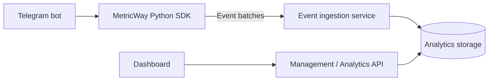

# MetricWay Architecture Case Study

A public architecture overview of **MetricWay**, a product analytics platform for Telegram bots.

The application repository is private. This repository documents the system architecture and engineering trade-offs at a high level. It contains no production application code, credentials, internal endpoints, infrastructure secrets, or user data.

## System overview

Event ingestion is separate from the user-facing API. This reduces coupling between event collection and dashboard traffic, allowing the two paths to evolve independently for different workloads.

## Public SDK

The open-source [metricway-sdk](https://github.com/urlifeceo/metricway-sdk) is an asynchronous Python library for Telegram bots. It provides:

- Non-blocking event collection.
- A bounded in-memory queue.
- Background batch delivery.
- Retries with backoff for temporary failures.
- Graceful shutdown with a time limit.
- Optional aiogram 3 integration.
- Automated tests and CI.

For installation and a runnable integration example, see the [SDK README](https://github.com/urlifeceo/metricway-sdk#readme).

## Engineering decisions

### Separate event ingestion service

Analytics events primarily create a write-heavy workload, while the dashboard API follows a request/response model. A separate ingestion service allows limits, reliability behavior, and scaling to be configured independently.

### Analytics should not interrupt the bot

Analytics failures should not stop the Telegram bot's business logic. The SDK therefore uses best-effort delivery and keeps network requests outside bot handlers.

### Explicit resource limits

Queue size, batch size, retry count, and shutdown time are bounded. Under overload, the SDK has defined behavior instead of accumulating data indefinitely. Events can be lost when the queue is full, retries are exhausted, or the process exits.

### Storage for analytical workloads

MetricWay uses ClickHouse for analytics data. Events are sent in batches, reducing the need for a separate network and database round trip for every event.

## Reading guide

The detailed documents below are currently in Russian:

| Document | Topics |
| --- | --- |
| [System architecture](docs/architecture.md) | Components, responsibilities, and data flow |
| [Event ingestion](docs/event-ingestion.md) | Collection, batching, and delivery |
| [Reliability and trade-offs](docs/reliability.md) | Failure handling and delivery limits |

This is a documentation repository; there is no application to install or run here.

## Technology stack

`Python` · `asyncio` · `FastAPI` · `Go` · `Fiber` · `ClickHouse` · `Docker` · `pytest` · `GitHub Actions`

## Contributing

When updating the case study, keep descriptions consistent with the public SDK and check that diagrams and relative links still render correctly. Keep examples free of credentials and user data.
