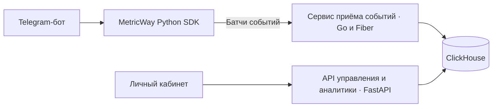

# Архитектура MetricWay

**Русский** · [English](README.en.md)

MetricWay — платформа продуктовой аналитики для Telegram-ботов. Этот репозиторий описывает, как события от ботов попадают в хранилище и как личный кабинет получает метрики.

## Два потока данных

- **Приём событий.** SDK собирает записи в процессе бота и отправляет их батчами в сервис приёма. Сервис записывает их в ClickHouse.
- **Работа с аналитикой.** Личный кабинет обращается к FastAPI. API отвечает за аутентификацию, управление проектами и аналитические запросы к ClickHouse.

Сервис приёма получает постоянный поток записей, а API обслуживает запросы из кабинета. Разделение позволяет настраивать лимиты и масштабировать эти сервисы независимо.

## Доставка событий

Открытый Python SDK поддерживает ручную отправку и автоматический сбор через aiogram 3. Методы SDK помещают события в ограниченную очередь в памяти, а фоновая задача отправляет батчи. При временном сбое SDK повторяет отправку с увеличивающейся задержкой. При остановке бота у SDK есть ограниченное время, чтобы отправить остаток очереди. [Установка и пример подключения](https://github.com/urlifeceo/metricway-sdk#readme)

Доставка работает по модели best effort. При переполнении очереди SDK отбрасывает новые события и возвращает управление боту. Аварийная остановка процесса или исчерпание повторов могут привести к потере записей. Такой компромисс позволяет боту продолжать работу при проблемах с аналитикой.

ClickHouse обрабатывает аналитические запросы и агрегации по времени. Батчи уменьшают число HTTP-запросов от ботов и операций записи в хранилище.

## Документация

| Раздел | Содержание |
| --- | --- |
| [Архитектура системы](docs/architecture.md) | Компоненты, границы ответственности и потоки данных |
| [Приём событий](docs/event-ingestion.md) | Формирование батчей, повторы и поведение при перегрузке |
| [Надёжность и компромиссы](docs/reliability.md) | Сценарии сбоев и границы гарантий доставки |

## Стек

`Python` · `asyncio` · `FastAPI` · `Go` · `Fiber` · `ClickHouse` · `Docker` · `pytest` · `GitHub Actions`

## Вклад в документацию

Сверяйте описания с публичным SDK, проверяйте схемы Mermaid и ссылки. Используйте вымышленные данные в примерах.
